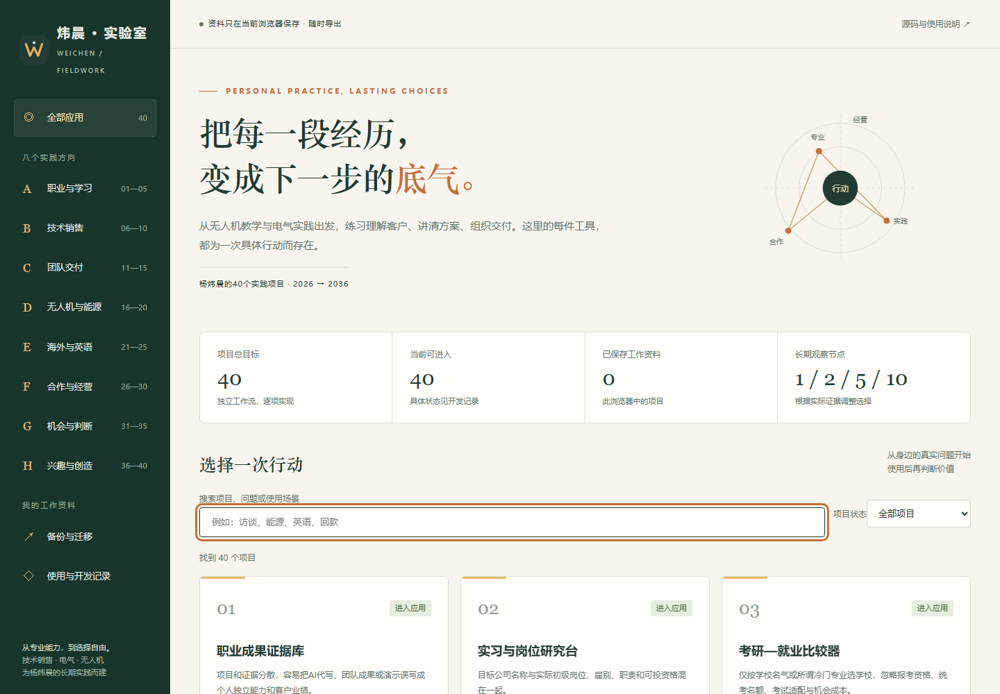
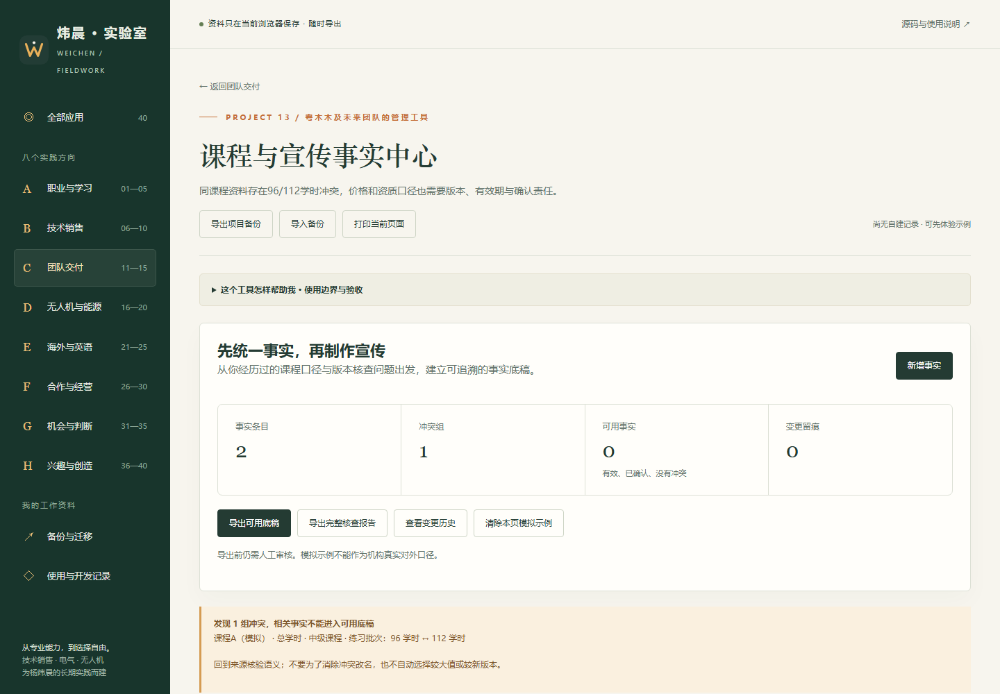
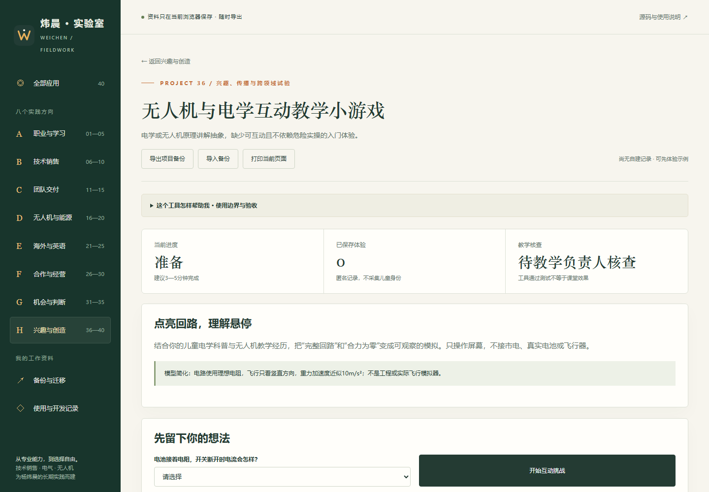

# 炜晨 · 行动实验室

围绕杨炜晨的电气本科、无人机教育与装调、技术销售方向和长期创业准备，开发40个有独立工作流的实践应用。共享导航、备份和界面组件，各项目保留自己的业务逻辑、使用边界与测试。

**1.0.0：40项软件工作流已实现。** 274项领域与数据测试、8组浏览器业务流程、40页电脑/手机检查及备份恢复已通过。它们是可继续扩展的个人实践工具；真实企业采用、能力提升与商业收益仍需要实际使用验证。

[在线入口](https://yangwei251003.github.io/weichen-career-lab/) · [40个应用逐项入口](docs/40个应用索引.md) · [原始项目范围](docs/项目范围.md) · [验收记录](docs/实施进度.md)



## 从这几个开始

- [13 课程与宣传事实中心](https://yangwei251003.github.io/weichen-career-lab/#/project/13)：处理96/112学时模拟冲突，练习核查、留痕和底稿导出。
- [07 客户需求访谈教练](https://yangwei251003.github.io/weichen-career-lab/#/project/07)与[21 英语技术演示陪练](https://yangwei251003.github.io/weichen-career-lab/#/project/21)：围绕你的技术销售方向练习。
- [19 能策行业验证](https://yangwei251003.github.io/weichen-career-lab/#/project/19)：导入本人原项目V3/CNY证据，复核计算与工作流价值。
- [36 无人机与电学互动教学](https://yangwei251003.github.io/weichen-career-lab/#/project/36)：体验可操作的安全教学模拟。

## 使用

选择项目，体验清楚标注的示例，输入真实资料并完成一次工作。每页顶部可以导出JSON备份、预览恢复和打印。模块内另有相应报告、CSV或训练输出。

应用不需要账号，不调用外部模型，不上传你的输入。**你的记录存在当前浏览器，GitHub只保存应用源码**；换电脑、换浏览器或清理浏览器前请备份。总备份可在「备份与迁移」里拆成单项目，再进入对应项目恢复。录音和其他另行下载的文件需要单独保存。

## 本地运行与验证

需要Node.js 22或更高版本，运行时无第三方依赖，也无需npm install。

```text
npm start
npm test
npm run build
```

本地地址为 `http://127.0.0.1:8040`，可通过环境变量PORT改变。静态成果位于dist，可由任何常规静态服务器提供。ES模块不能通过双击file://完整运行。

自动测试使用Node内置测试器。浏览器验收使用Python Playwright，在独立临时浏览器上下文内执行，不读取用户资料。完整回归入口：

```text
python -m pip install -r requirements-qa.txt
python -m playwright install chromium
python qa/run_all.py
```

可用 `python qa/run_all.py --url URL` 检查部署版。需具备安装测试依赖的网络条件；日常应用不依赖这些测试包。

## 目录与数据

- `src/groups/g1`—`g8`：8组、40个专用应用。
- `src/core.js`：表单、导出、校验、版本与存储；`src/main.js`：导航和备份界面。
- `src/catalog.js`：公开且去私人路径的原始项目规格。
- `tests`：领域规则与错误路径的自动测试。
- `docs`：使用、参考来源、验收与已知限制。
- `.github/workflows/pages.yml`：通过自动测试后构建并发布GitHub Pages。

仓库保存源码、原创SVG、规格、测试及必要的真实截图。构建目录由CI生成；浏览器私有资料、个人凭据、公司文件不入库。不要求也不读取任何私人API密钥。

## 参考与边界

每组参考官方产品、开放标准或开源工作流，见 `docs/research-g*.md`。参考的是任务与信息组织方法，代码和图形独立编写，不搬用未经许可的商用界面或素材。原创部分MIT许可。

示例客户、金额、设备、机构和情景会明确标记；用户已授权的个人简历事实单独注明依据边界。软件可运行不代表实际业务采用、上岸概率、真实收益、工程安全认证或财务法律意见。条件不足的项目提供完整可用的软件工作流，由真实使用继续验证价值。

## 更多实拍与版本





[更新记录](docs/CHANGELOG.md) · [验收详情](docs/实施进度.md) · [研究方法](docs/研究与设计方法.md)
